# Docker 개발 워크스테이션 실습

## 미션 목표

터미널에서 파일과 폴더, 권한을 다루고 Docker 이미지와 컨테이너를 실행했다. Dockerfile로 NGINX 웹 서버 이미지를 만들고, 포트 연결, 바인드 마운트, 볼륨의 데이터 보존을 확인했다.

## 실행 환경

- OS: Windows Pro, 빌드 26200
- 터미널: PowerShell, Ubuntu Bash (WSL 2)
- Docker Desktop: 4.97.0
- Docker Engine: 29.9.2
- Git: Windows 실습 `2.55.0.windows.5`, WSL Ubuntu 보완 실습 `2.53.0`
- 보완 실습 셸·경로: zsh, `/home/bbbbbbb25812581/projects/myapp/20261104/E1-1`

## 최종 보완 요약 (2026-11-04)

기존 Windows PowerShell 실습에 더해 WSL 2의 Linux 홈 경로에서 파일 조작·권한·Docker 운영·볼륨·바인드 마운트·이미지 빌드와 웹 접속을 보완했다. 아래 이미지는 실제 실행 화면이며 명령과 결과의 상세 기록은 각 절에 있다. Windows 실습의 `C:\Users\bshin\mission-web`와 WSL 실습의 `/home/bbbbbbb25812581/projects/myapp/20261104/E1-1`은 서로 다른 작업 사본이다.

| 확인 항목 | 실제 화면 |
| --- | --- |
| WSL 환경·Git 설정·브랜치·원격 주소 | [WSL·Git](evidence/wsl-gi.png) |
| 파일·폴더 생성·복사·이동·삭제 | [기본 조작](evidence/wsl-files.png) |
| 디렉터리 권한 755 → 700 → 755 | [권한 변경](evidence/wsl-permission.png) |
| Dockerfile 빌드 완료·이미지 목록 | [빌드](evidence/wsl-build.png) |
| 커스텀 이미지 실행·HTTP 200 | [실행·접속](evidence/wsl-web.png) |
| 주소창과 웹페이지 | [브라우저](evidence/wsl-browser.png) |
| 바인드 마운트 수정 전·후 HTTP 200 | [변경 반영](evidence/wsl-bind.png) |
| 컨테이너 삭제 전·후 볼륨 데이터 | [볼륨 보존](evidence/wsl-volume.png) |
| 촬영용 웹 컨테이너 중지·삭제 | [정리](evidence/wsl-web-cleanup.png) |

발표 자료: [presentation/index.html](presentation/index.html). 브라우저에서 열어 좌우 방향키로 이동하고 `N`으로 발표 노트를 표시한다. 수행 결과와 개념 설명은 학습 기록이며 평가 통과를 보장하는 표시는 아니다.

## 수행 체크리스트

- [x] 터미널 위치·목록·파일·폴더 조작
- [x] 파일과 폴더 권한 변경
- [x] Docker 버전과 엔진 확인
- [x] `hello-world` 실행
- [x] Ubuntu 컨테이너에서 명령 실행
- [x] Dockerfile로 NGINX 커스텀 이미지 빌드
- [x] 포트 매핑으로 웹 페이지 접속
- [x] 바인드 마운트로 파일 변경 반영
- [x] Docker 볼륨의 데이터 보존 확인
- [x] Git 사용자 정보와 기본 브랜치 확인
- [x] GitHub 저장소 생성 및 업로드
- [x] VS Code와 GitHub 연동 완료
- [x] Docker Desktop 화면 실행 오류 해결 및 Ubuntu WSL 연동 확인

## 프로젝트 폴더 구성

루트 폴더에서 확인한 실제 목록:

```powershell
get-childitem -name
```

```text
docs
evidence
site
Dockerfile
README.md
```

웹사이트 원본, 실행 방법, 확인 자료를 찾기 쉽게 나누었다.

| 경로 | 역할 |
| --- | --- |
| `site/index.html` | NGINX가 제공하는 웹페이지 원본 |
| `Dockerfile` | `site` 폴더를 NGINX 이미지에 복사하는 빌드 설명서 |
| `README.md` | 실습 명령, 실제 출력, 개념과 문제 해결 기록 |
| `docs/screenshots/` | VS Code와 GitHub 연동 화면 이미지 |
| `evidence/` | Docker 정보와 8081 웹 접속을 확인한 보조 이미지 |

## 실제 화면 증빙

아래는 기존 Windows 실습에서 저장한 실제 화면이다. 이후 WSL 보완 실습의 명령·출력 기록과는 촬영 시점을 구분한다.

### Docker 설치·엔진 정보

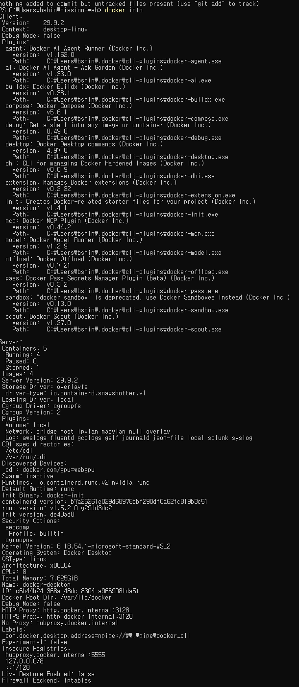

### Ubuntu 컨테이너 내부 명령과 exec 종료 후 상태

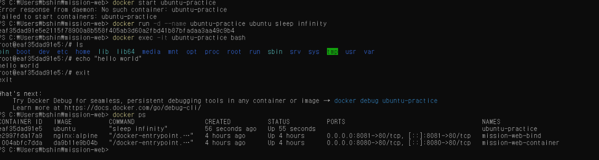

### 브라우저 포트 접속

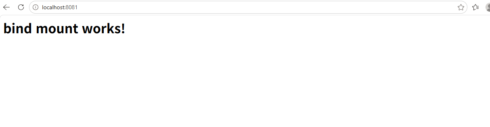

위 브라우저 이미지는 `bind mount works!`가 표시된 시점의 증거이며, 이후 `restored!` 변경이나 WSL의 `before-change`·`after-change` 비교를 보여주는 이미지는 아니다.

## 기본 터미널 조작 보완 실습 (2026-11-04)

기존 Windows 실습에 이어 WSL 2의 Linux 홈 폴더에서 기본 파일·폴더 조작을 수행했다. 사용자 터미널에서 `uname -a`로 `microsoft-standard-WSL2`, `pwd`로 `/home/bbbbbbb25812581/projects/myapp/20261104`, `HOME`으로 `/home/bbbbbbb25812581`을 확인했다. 이번 보완 실습의 셸은 zsh다.

아래는 실제 실행한 명령과 출력의 발췌다. `set -x`의 추적 접두사와 폴더 이동 때 자동 실행된 zoxide 훅은 생략했다. `ls`는 별칭에 따라 `eza --group-directories-first`로 실행됐으며, 목록 출력은 eza 형식이다. `mktemp`가 만든 폴더 이름은 실행할 때마다 달라진다. 이 경로는 기존 Windows 실습 경로와 구분한다.

```bash
practice_dir=$(mktemp -d "$HOME/e1-terminal-XXXXXX")
cd "$practice_dir"
pwd
```

```text
/home/bbbbbbb25812581/e1-terminal-O2HPxy
```

폴더 두 개, 빈 파일과 숨김 파일을 만들고 텍스트를 저장한 뒤 목록·내용을 확인했다.

```bash
mkdir source archive
touch source/empty.txt .hidden-note
printf 'E1-1 terminal practice\n' > source/hello.txt
ls -la
```

```text
drwxr-xr-x - bbbbbbb25812581  4 Nov 15:04 archive
drwxr-xr-x - bbbbbbb25812581  4 Nov 15:04 source
.rw-r--r-- 0 bbbbbbb25812581  4 Nov 15:04 .hidden-note
```

```bash
ls -l source
```

```text
.rw-r--r--  0 bbbbbbb25812581  4 Nov 15:04 empty.txt
.rw-r--r-- 23 bbbbbbb25812581  4 Nov 15:04 hello.txt
```

```bash
cat source/hello.txt
```

```text
E1-1 terminal practice
```

파일을 복사하고 이름을 바꾼 뒤 다른 폴더로 이동했다. 이동한 폴더에서도 내용을 확인했다.

```bash
cp source/hello.txt source/hello-copy.txt
mv source/hello-copy.txt source/renamed.txt
mv source/renamed.txt archive/
cd archive
pwd
```

```text
/home/bbbbbbb25812581/e1-terminal-O2HPxy/archive
```

```bash
ls -la
```

```text
.rw-r--r-- 23 bbbbbbb25812581  4 Nov 15:04 renamed.txt
```

```bash
cat renamed.txt
```

```text
E1-1 terminal practice
```

복사본을 삭제하고 빈 디렉터리도 삭제했다. `rm` 다음의 `ls -la`에는 항목이 출력되지 않았다. 마지막 목록에서 `archive`가 사라지고 원본이 있는 `source`와 숨김 파일이 남은 것을 확인했다.

```bash
rm renamed.txt
ls -la
cd ..
rmdir archive
ls -la
```

```text
drwxr-xr-x - bbbbbbb25812581  4 Nov 15:04 source
.rw-r--r-- 0 bbbbbbb25812581  4 Nov 15:04 .hidden-note
```

`cp`는 원본을 남겨 복사하고, `mv`는 이름 변경과 위치 이동에 사용한다. `rm`은 파일을, `rmdir`는 빈 디렉터리를 삭제한다. `touch`로 만든 `empty.txt`의 크기는 0바이트였고, `ls -la`에서 점으로 시작하는 숨김 파일도 확인했다.

### 기본 조작 실제 화면 증빙

별도 폴더 `/home/bbbbbbb25812581/e1-files-M5k6JD`에서 기본 조작을 재확인한 실제 화면이다. 이번에는 `command ls`를 사용해 별칭 대신 ls 자체를 실행했다.

```bash
pwd
mkdir source archive
touch source/empty.txt .hidden
printf 'terminal practice\n' > source/hello.txt
command ls -la
command ls -l source
cp source/hello.txt source/copy.txt
mv source/copy.txt archive/renamed.txt
cat archive/renamed.txt
rm archive/renamed.txt
rmdir archive
command ls -la
```

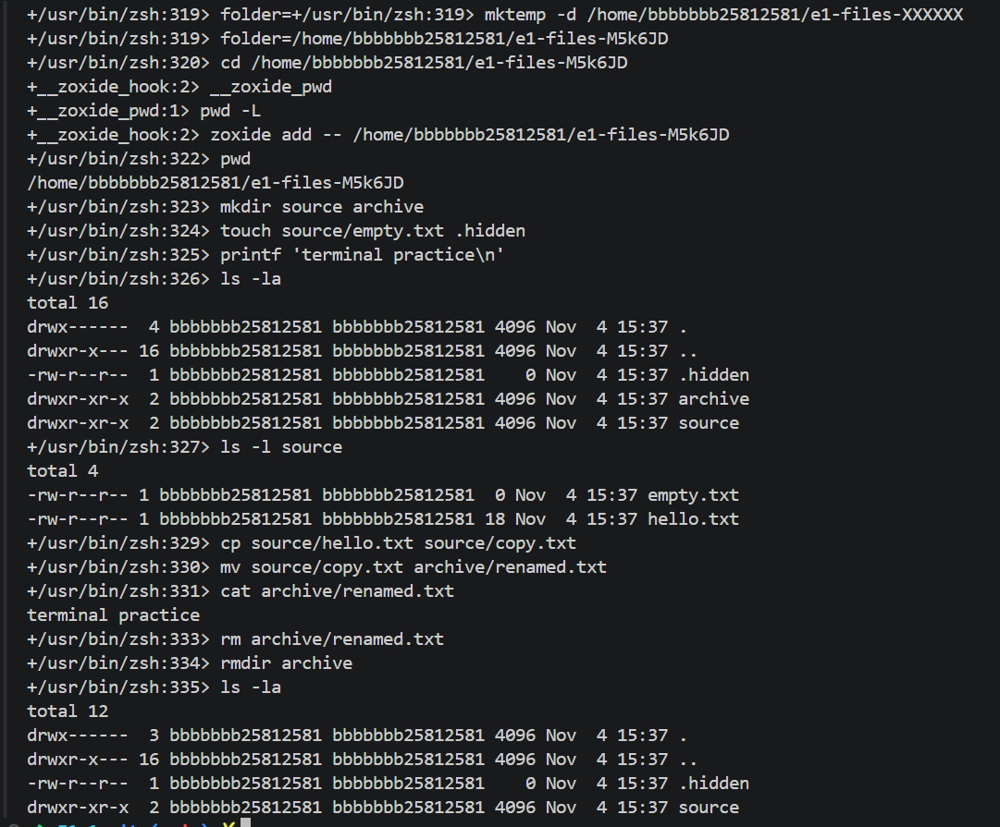

`empty.txt`는 0바이트, `hello.txt`는 18바이트였다. 복사본을 `archive/renamed.txt`로 옮긴 후 `terminal practice`를 읽었고, 복사본과 archive 삭제 후 최종 목록에는 `.hidden`과 `source`가 남았다.

## Linux 파일 권한 변경 실습

Ubuntu의 사용자 폴더에서 실습용 파일을 만들고, 권한 변경 전후의 실제 출력을 확인했다.

```bash
mkdir -p ~/permission-practice
touch ~/permission-practice/hello.txt
ls -l ~/permission-practice/hello.txt
```

```text
-rw-r--r-- 1 bshin bshin 0 Nov  3 13:02 /home/bshin/permission-practice/hello.txt
```

`chmod 600`으로 파일 주인에게만 읽기와 쓰기 권한을 남겼다.

```bash
chmod 600 ~/permission-practice/hello.txt
ls -l ~/permission-practice/hello.txt
```

```text
-rw------- 1 bshin bshin 0 Nov  3 13:02 /home/bshin/permission-practice/hello.txt
```

권한 숫자는 주인·그룹·그 밖의 사용자 순서다. 읽기(`r`)는 4, 쓰기(`w`)는 2, 실행(`x`)은 1이며 허용할 권한을 더한다. 따라서 `600`은 주인에게 읽기와 쓰기(`4+2=6`)를 주고, 그룹과 그 밖의 사용자에게는 권한을 주지 않는다는 뜻이다.

예를 들어 `755`는 주인에게 읽기·쓰기·실행(`4+2+1=7`), 그룹과 그 밖의 사용자에게 읽기·실행(`4+1=5`)을 주는 권한이다. 이 값은 숫자 계산을 설명하기 위한 예시이며, 위 파일에 실제로 설정한 값은 `600`이다.

### 디렉터리 권한 변경 보완 실습 (2026-11-04)

WSL 2의 zsh에서 별도 실습 디렉터리를 만들고 `stat`으로 권한 변경 전후를 확인했다. 아래 실제 명령·출력에서는 `set -x`의 추적 접두사만 생략했다. `mktemp`가 만드는 경로는 실행할 때마다 달라진다.

```bash
permission_dir=$(mktemp -d "$HOME/e1-permission-XXXXXX")
mkdir "$permission_dir/shared"
stat -c '%A %a %n' "$permission_dir/shared"
```

```text
drwxr-xr-x 755 /home/bbbbbbb25812581/e1-permission-NiOg3f/shared
```

```bash
chmod 700 "$permission_dir/shared"
stat -c '%A %a %n' "$permission_dir/shared"
```

```text
drwx------ 700 /home/bbbbbbb25812581/e1-permission-NiOg3f/shared
```

```bash
chmod 755 "$permission_dir/shared"
stat -c '%A %a %n' "$permission_dir/shared"
```

```text
drwxr-xr-x 755 /home/bbbbbbb25812581/e1-permission-NiOg3f/shared
```

실제 터미널에서 권한 변경 명령과 결과를 함께 캡처했다.

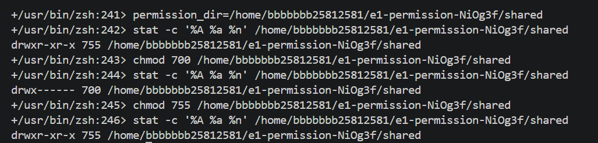

디렉터리의 권한은 실제로 `755 → 700 → 755`로 바뀌었다. `700`은 소유자에게만 읽기·쓰기·탐색 권한을 주고, `755`는 그룹과 그 밖의 사용자에게도 읽기·탐색 권한을 준다. 디렉터리에서 `r`은 이름 목록 읽기, `w`는 항목 생성·삭제·이름 변경, `x`는 디렉터리 진입과 내부 경로 탐색에 해당한다. 항목 생성·삭제에는 보통 해당 디렉터리의 `w`와 `x`가 함께 필요하다.

이번 실습은 권한 비트 변경을 확인한 것이다. `mktemp -d`로 만든 상위 폴더의 접근 권한도 영향을 주므로, `shared`를 `755`로 바꿨다고 다른 사용자가 실제로 접근할 수 있음을 검증한 것은 아니다.

참고로 일반 파일의 `644`는 소유자 읽기·쓰기, 그룹과 그 밖의 사용자 읽기 권한이며 실행 권한은 없다. 기존 파일의 `600` 변경과 이번 디렉터리 변경으로 파일·디렉터리 각각의 권한 변경 증거를 기록했다.

## Docker 기본 확인

PowerShell에서 실행했다.

Docker Desktop 실행 상태를 확인한 실제 출력:

```powershell
docker desktop status
```

```text
Name                Value
Status              running
SessionID           df3483af-556f-44ea-9636-e5ccaf363bd1
```

Docker CLI 버전을 확인한 실제 출력:

```powershell
docker --version
```

```text
Docker version 29.9.2, build a82e528
```

`docker version`에서 확인한 Client와 Server 출력:

```powershell
docker version
```

```text
Client:
 Version:           29.9.2
 API version:       1.56
 Go version:        go1.26.10
 Git commit:        a82e528
 Built:             Tue Oct 20 19:44:07 2026
 OS/Arch:           windows/amd64
 Context:           desktop-linux

Server: Docker Desktop 4.97.0 (244584)
 Engine:
  Version:          29.9.2
  API version:      1.56 (minimum version 1.40)
  Go version:       go1.26.10
  Git commit:       0367cbe
  Built:            Tue Oct 20 18:45:02 2026
  OS/Arch:          linux/amd64
  Experimental:     false
 containerd:
  Version:          v2.4.2
  GitCommit:        b7a25261e029d68978bbf290df0a62fc819b3c51
 runc:
  Version:          1.5.2
  GitCommit:        v1.5.2-0-g29dd3dc2
 docker-init:
  Version:          0.19.0
  GitCommit:        de40ad0
```

```powershell
docker run hello-world
docker images
docker ps
docker ps -a
docker logs ubuntu-practice
docker stats --no-stream ubuntu-practice
```

`docker run hello-world` 실행 결과:

```text
Unable to find image 'hello-world:latest' locally
latest: Pulling from library/hello-world
4f55086f7dd0: Pull complete
d5e71e642bf5: Download complete
Digest: sha256:c567b231f65614688711a75f31518a064258a51d442117a3e771a3a8fdba78ef
Status: Downloaded newer image for hello-world:latest

Hello from Docker!
This message shows that your installation appears to be working correctly.

To generate this message, Docker took the following steps:
 1. The Docker client contacted the Docker daemon.
 2. The Docker daemon pulled the "hello-world" image from the Docker Hub.
    (amd64)
 3. The Docker daemon created a new container from that image which runs the
    executable that produces the output you are currently reading.
 4. The Docker daemon streamed that output to the Docker client, which sent it
    to your terminal.

To try something more ambitious, you can run an Ubuntu container with:
 $ docker run -it ubuntu bash

Share images, automate workflows, and more with a free Docker ID:
 https://hub.docker.com/

For more examples and ideas, visit:
 https://docs.docker.com/get-started/
```

`docker images` 실행 결과 (`U`는 사용 중인 이미지 표시):

```text
IMAGE                ID             DISK USAGE   CONTENT SIZE   EXTRA
hello-world:latest   c567b231f656       25.9kB         9.49kB    U
mission-web:1.0      da9b11e9b04b       93.6MB         26.3MB    U
nginx:alpine         785835ea65db       94.5MB         27.2MB    U
ubuntu:latest        6a06111c3b0a        163MB         45.9MB
```

`docker ps -a` 실행 결과:

```text
CONTAINER ID   IMAGE             COMMAND                   CREATED              STATUS                          PORTS                                     NAMES
d60ff015c57f   hello-world       "/hello"                  About a minute ago   Exited (0) About a minute ago                                             brave_einstein
e2997fda17a9   nginx:alpine      "/docker-entrypoint.…"   38 minutes ago       Up 38 minutes                   0.0.0.0:8081->80/tcp, [::]:8081->80/tcp   mission-web-bind
1004abfc7dda   mission-web:1.0   "/docker-entrypoint.…"   39 minutes ago       Up 39 minutes                   0.0.0.0:8080->80/tcp, [::]:8080->80/tcp   mission-web-container
```

이미지는 컨테이너를 만드는 데 쓰는 실행 파일 묶음이고, 컨테이너는 그 이미지로 만든 실행 단위다. 실제 목록에서 `mission-web:1.0`은 이미지이며, 이 이미지로 실행한 `mission-web-container`는 컨테이너다. `hello-world` 이미지는 목록에 남아 있지만, 실행한 컨테이너 `brave_einstein`은 메시지를 출력한 뒤 `Exited (0)` 상태가 됐다.

`docker build`는 Dockerfile과 `site` 파일로 이미지를 만들고, `docker run`은 그 이미지에서 컨테이너를 만든다. `site`를 고쳐 이미지를 다시 빌드해도 이미 실행 중인 8080 컨테이너의 내용은 자동으로 바뀌지 않았다. 반면 바인드 마운트로 연결한 8081 컨테이너에는 파일 수정이 바로 반영됐다.

hello-world 출력에서 Hello from Docker!를 확인했다. Ubuntu 컨테이너에서는 ls와 echo를 실행했다. docker exec로 연 Bash에서 exit한 뒤에도 컨테이너가 계속 실행되는 것을 확인했다.

### WSL Ubuntu에서 Docker 연결 재확인 (2026-11-04)

기존 Windows 실습과 별도로, WSL Ubuntu 터미널에서 Linux Docker 엔진에 연결되는지 확인했다. 아래 목록은 이 보완 시점의 실제 상태이며, 앞서 기록한 Windows 실습 당시의 컨테이너 목록과 다르다.

```bash
docker --version
```

```text
Docker version 29.9.2, build a82e528
```

```bash
docker info --format 'OSType={{.OSType}} ServerVersion={{.ServerVersion}}'
```

```text
OSType=linux ServerVersion=29.9.2
```

```bash
docker ps -a --format 'table {{.Names}}\t{{.Image}}\t{{.Status}}\t{{.Ports}}'
```

```text
NAMES                 IMAGE         STATUS                      PORTS
friendly_merkle       nginx         Up 51 minutes               0.0.0.0:8082->80/tcp, [::]:8082->80/tcp
xenodochial_curran    nginx         Created
xenodochial_almeida   nginx         Up 52 minutes               0.0.0.0:8080->80/tcp, [::]:8080->80/tcp
practical_torvalds    hello-world   Exited (0) 52 minutes ago
sweet_chatterjee      hello-world   Exited (0) 53 minutes ago
```

`docker info`의 실제 응답에서 Linux 엔진 버전 29.9.2를 확인했다. `Up`은 실행 중, `Created`는 생성됐지만 아직 실행 중이 아닌 상태, `Exited (0)`은 종료 코드 0으로 종료된 상태다. 이 시점에는 호스트 8080·8082 포트가 사용 중이었다.

### Ubuntu 내부 명령과 운영 로그 보완 (2026-11-04)

보완 실습에서는 별도 Ubuntu 컨테이너 `e1-ops-20261104150811`을 사용했다. 생성 명령은 다음과 같다. 보관한 출력은 이미지 목록부터 시작하며, 실제 컨테이너 ID와 실행 상태는 이후 `docker ps` 결과에서 확인했다.

```bash
container_name="e1-ops-$(date +%Y%m%d%H%M%S)"
docker run -d --name "$container_name" ubuntu \
  sh -c 'echo e1-container-started; exec sleep infinity'
```

다음은 실습 터미널에서 확인한 실제 명령·출력이다. 추적 접두사는 생략했다.

```bash
docker images ubuntu
```

```text
IMAGE           ID             DISK USAGE   CONTENT SIZE   EXTRA
ubuntu:latest   6a06111c3b0a        163MB         45.9MB    U
```

```bash
docker exec e1-ops-20261104150811 bash -c 'echo inside-ubuntu; ls /; exit'
```

```text
inside-ubuntu
bin
boot
dev
etc
home
lib
lib64
media
mnt
opt
proc
root
run
sbin
srv
sys
tmp
usr
var
```

```bash
docker ps --filter 'name=e1-ops-20261104150811'
```

```text
CONTAINER ID   IMAGE     COMMAND                  CREATED                  STATUS                  PORTS     NAMES
bd81ef07c2a3   ubuntu    "sh -c 'echo e1-cont…"   Less than a second ago   Up Less than a second             e1-ops-20261104150811
```

```bash
docker logs e1-ops-20261104150811
```

```text
e1-container-started
```

```bash
docker stats --no-stream e1-ops-20261104150811
```

```text
CONTAINER ID   NAME                    CPU %     MEM USAGE / LIMIT    MEM %     NET I/O      BLOCK I/O   PIDS
bd81ef07c2a3   e1-ops-20261104150811   0.00%     3.27MiB / 15.25GiB   0.02%     390B / 84B   0B / 0B     1
```

`docker exec`는 실행 중인 컨테이너에 별도 프로세스를 실행한다. 이번 Bash가 `exit`한 뒤에도 메인 프로세스인 `sleep infinity`가 남아 `Up` 상태를 유지했다. `docker logs`는 컨테이너 메인 프로세스의 표준 출력·오류 로그를 확인하는 명령이다. 별도로 실행한 exec 명령의 `inside-ubuntu` 출력은 이번 logs 결과에 포함되지 않았다. `docker stats --no-stream`은 자원 사용량을 한 번 출력하며, 위 수치는 측정 시점에 따라 달라진다.

### 실습 컨테이너 중지·삭제 확인 (2026-11-04)

위 운영 실습에서 만든 컨테이너만 중지하고 삭제했다. 실제 명령·출력은 다음과 같다. 추적 접두사는 생략했다.

```bash
docker stop e1-ops-20261104150811
```

```text
e1-ops-20261104150811
```

```bash
docker ps -a --filter 'name=e1-ops-20261104150811'
```

```text
CONTAINER ID   IMAGE     COMMAND                  CREATED              STATUS                                PORTS     NAMES
bd81ef07c2a3   ubuntu    "sh -c 'echo e1-cont…"   About a minute ago   Exited (137) Less than a second ago             e1-ops-20261104150811
```

```bash
docker inspect --format 'Status={{.State.Status}} Running={{.State.Running}}' e1-ops-20261104150811
```

```text
Status=exited Running=false
```

```bash
docker rm e1-ops-20261104150811
```

```text
e1-ops-20261104150811
```

```bash
docker ps -a --filter 'name=e1-ops-20261104150811'
```

```text
CONTAINER ID   IMAGE     COMMAND   CREATED   STATUS    PORTS     NAMES
```

`exec`로 실행한 Bash 종료 후에는 컨테이너가 `Up`으로 유지됐지만, `docker stop` 후에는 `exited`, `Running=false`로 바뀌었다. 중지된 컨테이너는 삭제 전까지 `docker ps -a`에 남았고, `docker rm` 후에는 해당 목록이 헤더만 출력됐다. 따라서 추가 프로세스 종료, 컨테이너 중지, 컨테이너 삭제를 구분해 확인했다.

이번 중지 결과의 종료 코드는 실제로 `137`이었다. 이를 정상 종료 코드 `0`으로 기록하지 않는다. 제공된 로그만으로 종료 코드의 구체적인 원인은 단정하지 않으며, 이번에 확인한 사항은 실행 중지와 삭제 여부다.

## 웹 서버 이미지와 포트 연결

site/index.html을 NGINX 웹 서버가 제공하도록 Dockerfile을 작성했다.

실제 `Dockerfile` 내용:

```dockerfile
FROM nginx:alpine
COPY site/ /usr/share/nginx/html/
```

`FROM`은 사용할 기본 이미지가 `nginx:alpine`임을 뜻한다. `COPY`는 이 폴더의 `site/` 내용을 이미지 안의 `/usr/share/nginx/html/`에 복사한다.

현재 `site/index.html` 내용 (`Get-Content site/index.html`로 확인):

```html
<h1>bind mount restored!</h1>
```

빌드와 실행 명령:

```powershell
docker build -t mission-web:1.0 .
docker run -d --name mission-web-container -p 8080:80 mission-web:1.0
```

이미지를 다시 빌드하며 확인한 실제 출력 (`CACHED`는 기존 기본 이미지 재사용을 뜻한다):

```text
[+] Building 1.1s (7/7) FINISHED                                                  docker:desktop-linux
 => [internal] load build definition from Dockerfile                                              0.0s
 => => transferring dockerfile: 91B                                                               0.0s
 => [internal] load metadata for docker.io/library/nginx:alpine                                   0.1s
 => [internal] load .dockerignore                                                                 0.0s
 => => transferring context: 2B                                                                   0.0s
 => CACHED [1/2] FROM docker.io/library/nginx:alpine@sha256:785835ea65db4bba6f021acc0f3be91b0fef  0.1s
 => => resolve docker.io/library/nginx:alpine@sha256:785835ea65db4bba6f021acc0f3be91b0fef76a53fe  0.1s
 => [internal] load build context                                                                 0.0s
 => => transferring context: 101B                                                                 0.0s
 => [2/2] COPY site/ /usr/share/nginx/html/                                                       0.1s
 => exporting to image                                                                            0.5s
 => => exporting layers                                                                           0.2s
 => => exporting manifest sha256:5e662e58d1c7482e23721ee01ea256b423602ba2ce17b0c5ea16725e96db43c  0.1s
 => => exporting config sha256:9d8802f8a45a4c2790090ea3fc89e06760d57ccb0b998de402bb253058af3298   0.0s
 => => exporting attestation manifest sha256:e993b3ebca3145f97a34950a13a7589509f077cef94d7e06a2d  0.0s
 => => exporting manifest list sha256:0d36ee2965e082439404929aa6c041fefdd348181db29a9a7ec1edfe63  0.0s
 => => naming to docker.io/library/mission-web:1.0                                                0.0s
 => => unpacking to docker.io/library/mission-web:1.0                                             0.1s
```

브라우저에서 http://localhost:8080으로 접속해 페이지를 확인했다. `-p 8080:80`은 내 PC의 8080 포트를 컨테이너의 80 포트에 연결한다. 컨테이너는 독립된 네트워크 공간을 쓰므로 이 연결을 지정해야 내 PC에서 컨테이너의 NGINX에 접속할 수 있다. 실제 `docker ps -a` 출력의 `0.0.0.0:8080->80/tcp`가 연결된 포트를 보여준다. 8081 컨테이너도 같은 방식으로 내 PC의 8081 포트를 컨테이너의 80 포트에 연결했다.

Windows 호스트에서 확인한 8080 포트의 실제 HTTP 응답:

```powershell
curl.exe -i http://localhost:8080
```

```http
HTTP/1.1 200 OK
Server: nginx/1.31.8
Date: Tue, 03 Nov 2026 04:13:25 GMT
Content-Type: text/html
Content-Length: 28
Last-Modified: Mon, 02 Nov 2026 12:07:37 GMT
Connection: keep-alive
ETag: "6ae87d09-1c"
Accept-Ranges: bytes

<h1>bind mount works!</h1>
```

8080 컨테이너는 앞서 빌드한 이미지로 실행 중이므로, 새 빌드 후에도 기존 컨테이너의 페이지 문구가 그대로 표시됐다.

### WSL Dockerfile 빌드 실제 화면 증빙

아래 명령에 대응하는 실제 터미널 캡처에서 Dockerfile 내용, 빌드 완료와 이미지 목록을 함께 확인했다.

```bash
cat Dockerfile
docker build -t e1-proof:1.0 .
docker images e1-proof
```

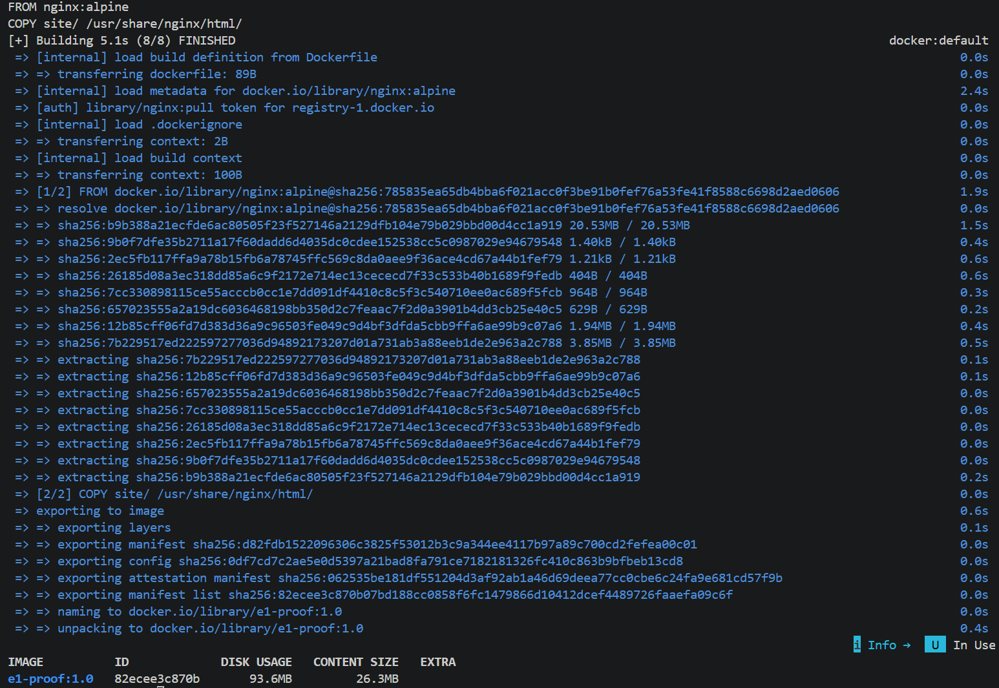

캡처에서 `Building 5.1s (8/8) FINISHED`, `COPY site/ /usr/share/nginx/html/`, `naming to docker.io/library/e1-proof:1.0`을 확인했다. 최종 목록에는 이미지 `e1-proof:1.0`, ID `82ecee3c870b`, 디스크 사용량 `93.6MB`, 콘텐츠 크기 `26.3MB`가 표시됐다. 이는 앞서 Windows에서 빌드한 `mission-web:1.0`과 구분되는 WSL 보완 실습이다.

### WSL 커스텀 이미지 실행·포트 접속 실제 화면

빌드한 `e1-proof:1.0`으로 컨테이너 `e1-web-shot-153338`을 실행했다. 아래는 캡처에 대응하는 명령이다.

```bash
docker run -d --name e1-web-shot-153338 -p 127.0.0.1::80 e1-proof:1.0
docker port e1-web-shot-153338 80/tcp
docker ps --filter 'name=e1-web-shot-153338'
curl --fail-with-body --retry 5 --retry-connrefused --retry-delay 1 --max-time 10 -i http://127.0.0.1:62962
```

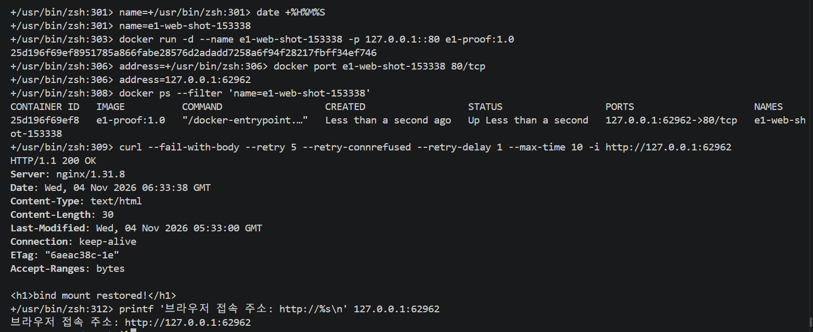

실제 캡처에서 컨테이너 ID `25d196f69ef8`, `Up` 상태, `127.0.0.1:62962->80/tcp` 포트 매핑을 확인했다. 응답은 `HTTP/1.1 200 OK`이고 본문은 `<h1>bind mount restored!</h1>`이었다. 이번 컨테이너는 바인드 마운트 없이 커스텀 이미지에 복사된 페이지를 제공한다. 본문의 문구는 기존 웹 원본의 내용이며 이번 실행에 바인드 마운트가 적용됐다는 뜻은 아니다.

Windows 브라우저에서도 같은 주소에 접속해 주소창과 페이지 본문을 함께 확인했다.

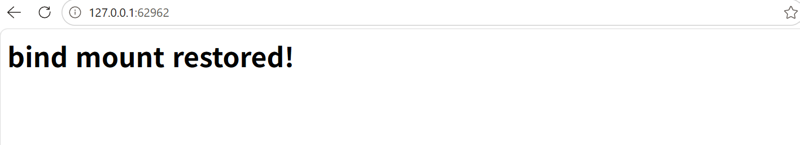

`62962`는 이번 실행에서 동적으로 배정된 호스트 포트다. 실행·curl·브라우저 캡처는 동일 컨테이너의 같은 주소를 확인한다. 촬영 후 다음 명령으로 컨테이너를 중지·삭제했다.

```bash
docker stop e1-web-shot-153338
docker rm e1-web-shot-153338
```

각 명령에서 컨테이너 이름 `e1-web-shot-153338`이 반환되는 실제 화면을 확인했다.

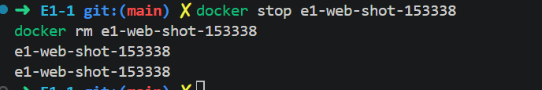

## 바인드 마운트

호스트의 `site` 폴더를 컨테이너의 NGINX 웹 폴더에 연결했다. `source=C:\Users\bshin\mission-web\site`는 이 PC에서 실제 웹페이지 파일이 있는 폴더이고, `target=/usr/share/nginx/html`은 NGINX가 웹페이지를 읽는 컨테이너 안의 폴더다. 다른 PC에서 실행할 때는 `source`를 그 PC의 실제 프로젝트 경로로 바꿔야 한다. `readonly`는 컨테이너에서 원본 폴더를 수정하지 못하게 한다.

경로를 고를 때 기준은 다음과 같다. `docker build ... .`의 `.`은 현재 작업 폴더를 뜻하고, Dockerfile의 `COPY site/ ...`에서 `site/`는 그 빌드 폴더를 기준으로 찾는 상대경로다. 바인드 마운트의 `source=C:\Users\bshin\mission-web\site`는 어느 폴더를 연결할지 정확히 지정해야 하므로 이 PC의 절대경로를 썼다. `target=/usr/share/nginx/html`은 컨테이너 안에서 NGINX가 읽는 위치를 가리키는 절대경로다.

```powershell
docker run -d --name mission-web-bind -p 8081:80 --mount "type=bind,source=C:\Users\bshin\mission-web\site,target=/usr/share/nginx/html,readonly" nginx:alpine
```

Windows 호스트에서 확인한 8081 포트의 실제 HTTP 응답:

```powershell
curl.exe -i http://localhost:8081
```

```http
HTTP/1.1 200 OK
Server: nginx/1.31.8
Date: Tue, 03 Nov 2026 04:13:57 GMT
Content-Type: text/html
Content-Length: 31
Last-Modified: Tue, 03 Nov 2026 03:33:30 GMT
Connection: keep-alive
ETag: "6ae9560a-1f"
Accept-Ranges: bytes

<h1>bind mount restored!</h1>
```

호스트의 `site/index.html` 문구를 `bind mount works!`에서 `bind mount restored!`로 바꾼 뒤 `http://localhost:8081`을 새로고침했다. 이미지를 다시 빌드하지 않아도 변경된 페이지가 표시됐다.

### WSL 바인드 마운트 보완 중 403 응답 (2026-11-04)

별도 실습 폴더 `/home/bbbbbbb25812581/e1-bind-dNkdlO`를 NGINX에 읽기 전용으로 연결했다. 이번 실습은 변경 전·후 응답이 모두 403이므로 변경 반영 성공으로 기록하지 않는다.

```bash
docker run -d --name e1-bind-20261104151403 -p 127.0.0.1::80 --mount 'type=bind,source=/home/bbbbbbb25812581/e1-bind-dNkdlO,target=/usr/share/nginx/html,readonly' nginx
docker port e1-bind-20261104151403 80/tcp
```

실제 생성 ID와 포트:

```text
f14542d9b654ddfa369f886bef6fd6263cc1ab6b95b5d4a1b2ab3fd674aadd3c
127.0.0.1:54514
```

호스트의 `index.html`에 `before-change`, 이어서 `after-change`를 저장하고 같은 주소를 요청했으나 두 번 모두 다음 상태가 반환됐다. 아래는 응답 헤더 발췌다.

```bash
curl --retry 5 --retry-connrefused --retry-delay 1 --max-time 10 -i http://127.0.0.1:54514
curl --max-time 10 -i http://127.0.0.1:54514
```

```http
HTTP/1.1 403 Forbidden
Server: nginx/1.31.8
Date: Wed, 04 Nov 2026 06:14:03 GMT
Content-Type: text/html
Content-Length: 153
Connection: keep-alive
```

`docker stop`와 `docker rm`은 각각 `e1-bind-20261104151403`을 출력했고 실습 컨테이너를 정리했다. 원인 가설은 `mktemp -d`로 생성한 원본 디렉터리의 접근 권한 부족이다. 당시에는 권한과 오류 로그를 확인하기 전이었다. 아래 후속 조사와 재검증에서 권한 문제와 해결 결과를 확인했다.

### 403 원인 조사: 원본 디렉터리 700과 접근 거부 로그

별도 확인 컨테이너를 생성해 같은 증상을 재현했다. 실제 권한 조회 결과:

```bash
stat -c '%A %a %n' /home/bbbbbbb25812581/e1-bind-dNkdlO /home/bbbbbbb25812581/e1-bind-dNkdlO/index.html
```

```text
drwx------ 700 /home/bbbbbbb25812581/e1-bind-dNkdlO
-rw-r--r-- 644 /home/bbbbbbb25812581/e1-bind-dNkdlO/index.html
```

```bash
docker run -d --name e1-bind-check-20261104151455 -p 127.0.0.1::80 --mount 'type=bind,source=/home/bbbbbbb25812581/e1-bind-dNkdlO,target=/usr/share/nginx/html,readonly' nginx
docker port e1-bind-check-20261104151455 80/tcp
```

```text
1e8cc32e0664669f2b01b37fde31ceebff77c4f7be4174054f6533f138af8ab7
127.0.0.1:53893
```

```bash
curl --retry 5 --retry-connrefused --retry-delay 1 --max-time 10 -i http://127.0.0.1:53893
```

실제 응답의 상태·서버·시각 발췌:

```http
HTTP/1.1 403 Forbidden
Server: nginx/1.31.8
Date: Wed, 04 Nov 2026 06:14:55 GMT
```

```bash
docker logs e1-bind-check-20261104151455
```

실제 로그 중 오류와 요청 기록 발췌:

```text
2026/11/04 06:14:55 [error] 28#28: *1 "/usr/share/nginx/html/index.html" is forbidden (13: Permission denied), client: 172.17.0.1, server: localhost, request: "GET / HTTP/1.1", host: "127.0.0.1:53893"
172.17.0.1 - - [04/Nov/2026:06:14:55 +0000] "GET / HTTP/1.1" 403 153 "-" "curl/8.18.0" "-"
```

파일 자체는 `644`지만, 마운트 원본 디렉터리는 소유자만 탐색할 수 있는 `700`이었다. 이 권한과 NGINX의 `Permission denied` 로그를 근거로 디렉터리 접근 권한을 문제 원인으로 좁혔다. 이후 해당 실습 디렉터리를 `755`로 변경했다. 동일 컨테이너로 재검증하려 했으나 컨테이너가 없어 새 컨테이너를 생성해 아래와 같이 검증했다.

### 권한 수정 후 재검증 시 컨테이너 부재 확인

후속 실행에서 실습 폴더를 `755`로 변경한 것은 확인했으나, 대상 컨테이너가 존재하지 않아 HTTP 검증은 실패했다. 컨테이너가 없어진 이유는 이 출력만으로 확인할 수 없다.

```bash
docker port e1-bind-check-20261104151455 80/tcp
```

```text
Error response from daemon: No such container: e1-bind-check-20261104151455
```

```bash
chmod 755 /home/bbbbbbb25812581/e1-bind-dNkdlO
stat -c '%A %a %n' /home/bbbbbbb25812581/e1-bind-dNkdlO /home/bbbbbbb25812581/e1-bind-dNkdlO/index.html
```

```text
drwxr-xr-x 755 /home/bbbbbbb25812581/e1-bind-dNkdlO
-rw-r--r-- 644 /home/bbbbbbb25812581/e1-bind-dNkdlO/index.html
```

포트 조회 실패로 `address`가 빈 문자열이 됐고, 변경 전·후 요청은 모두 아래 오류를 출력했다.

```text
curl: (3) URL rejected: No host part in the URL
```

후속 `docker logs`, `docker stop`, `docker rm`도 같은 `No such container` 오류를 반환했다. 이 시도는 권한 변경만 확인했으며 `200 OK`나 변경 반영 성공을 확인한 것으로 기록하지 않는다. 다음 재시도에서는 컨테이너를 새로 생성하고 포트 조회 실패 또는 HTTP 오류 시 즉시 중단하도록 했으며, 아래 성공 기록에서 결과를 확인했다.

### WSL 바인드 마운트 재검증 성공: 200 응답과 변경 반영

원본 디렉터리 권한을 `755`, 파일을 `644`로 지정하고 새 컨테이너를 만들었다. 이번에는 `set -ex`와 `test -n`으로 실패 시 후속 요청이 계속되지 않도록 했다. 실제 실행 명령은 다음과 같다. 컨테이너 이름과 포트는 이번 실행에서 확인된 값이다.

```bash
bind_dir=/home/bbbbbbb25812581/e1-bind-dNkdlO
bind_name=e1-bind-retry-20261104151721
chmod 755 "$bind_dir"
printf '<h1>before-change</h1>\n' > "$bind_dir/index.html"
chmod 644 "$bind_dir/index.html"
docker run -d --name "$bind_name" \
  -p 127.0.0.1::80 \
  --mount "type=bind,source=$bind_dir,target=/usr/share/nginx/html,readonly" nginx
```

실제 생성 ID:

```text
d6898c6eb0e3cb8c5118e404102055093c7afe75f84e5fceca1096bdef6e4b94
```

```bash
address=$(docker port "$bind_name" 80/tcp)
test -n "$address"
printf '접속 주소: http://%s\n' "$address"
```

```text
접속 주소: http://127.0.0.1:61324
```

변경 전 요청과 실제 응답:

```bash
curl --fail-with-body --retry 5 --retry-connrefused --retry-delay 1 --max-time 10 -i http://127.0.0.1:61324
```

```http
HTTP/1.1 200 OK
Server: nginx/1.31.8
Date: Wed, 04 Nov 2026 06:17:21 GMT
Content-Type: text/html
Content-Length: 23
Last-Modified: Wed, 04 Nov 2026 06:17:21 GMT
Connection: keep-alive
ETag: "6aeacdf1-17"
Accept-Ranges: bytes

<h1>before-change</h1>
```

호스트 파일만 수정한 뒤 같은 컨테이너·주소에 다시 요청했다.

```bash
printf '<h1>after-change</h1>\n' > "$bind_dir/index.html"
curl --fail-with-body --max-time 10 -i http://127.0.0.1:61324
```

```http
HTTP/1.1 200 OK
Server: nginx/1.31.8
Date: Wed, 04 Nov 2026 06:17:21 GMT
Content-Type: text/html
Content-Length: 22
Last-Modified: Wed, 04 Nov 2026 06:17:21 GMT
Connection: keep-alive
ETag: "6aeacdf1-16"
Accept-Ranges: bytes

<h1>after-change</h1>
```

```bash
docker logs --tail 5 e1-bind-retry-20261104151721
```

실제 출력 중 두 요청 기록 발췌:

```text
172.17.0.1 - - [04/Nov/2026:06:17:21 +0000] "GET / HTTP/1.1" 200 23 "-" "curl/8.18.0" "-"
172.17.0.1 - - [04/Nov/2026:06:17:21 +0000] "GET / HTTP/1.1" 200 22 "-" "curl/8.18.0" "-"
```

```bash
docker stop e1-bind-retry-20261104151721
docker rm e1-bind-retry-20261104151721
```

각 명령은 차례대로 다음 이름을 출력해 중지·삭제를 확인했다.

```text
e1-bind-retry-20261104151721
e1-bind-retry-20261104151721
```

**결과:** 두 요청 모두 `200 OK`이며 본문이 `before-change`에서 `after-change`로 바뀌었다. 이 두 요청 사이에 이미지 빌드·컨테이너 재시작은 하지 않았다. `readonly`는 컨테이너 쪽 쓰기를 제한하며, 호스트에서 원본을 수정하는 것은 허용한다.

**문제 해결:** 최초 디렉터리 `700` 및 NGINX `Permission denied` 확인 → 원본 디렉터리를 `755`로 변경 → 새 컨테이너에서 `200 OK`와 변경 반영 확인. 파일이 읽기 가능한 `644`여도 디렉터리 탐색 권한이 없으면 웹 서버가 파일을 읽을 수 없다는 점을 실습으로 확인했다. 중간 재검증에서는 대상 컨테이너 부재도 발생했으므로, 컨테이너 생성과 포트 조회부터 다시 수행했다.

**재현:** 새 실습 폴더는 `mktemp -d "$HOME/e1-bind-XXXXXX"`로 만들고 `chmod 755`를 적용한다. 컨테이너 이름도 새로 정하며 `-p 127.0.0.1::80`으로 배정된 포트를 `docker port`로 확인한다. 위의 `61324`는 고정 포트가 아니다.

### 바인드 마운트 실제 화면 증빙

실제 캡처에서는 컨테이너 `e1-bind-shot-152933`, 동적 호스트 주소 `127.0.0.1:58165`를 사용했다. 아래는 캡처에 대응하는 핵심 명령이다. 컨테이너 생성부터 중지·삭제까지의 추적 출력은 이미지에 포함돼 있다.

```bash
name=e1-bind-shot-152933
folder=/home/bbbbbbb25812581/e1-bind-dNkdlO
chmod 755 "$folder"
printf '<h1>before-change</h1>\n' > "$folder/index.html"
docker run -d --name "$name" -p 127.0.0.1::80 \
  --mount "type=bind,source=$folder,target=/usr/share/nginx/html,readonly" nginx
address=$(docker port "$name" 80/tcp)
curl --fail-with-body --retry 5 --retry-connrefused --retry-delay 1 --max-time 10 -sS -w 'HTTP %{http_code}\n' "http://$address"
printf '<h1>after-change</h1>\n' > "$folder/index.html"
curl --fail-with-body --max-time 10 -sS -w 'HTTP %{http_code}\n' "http://$address"
docker stop "$name"
docker rm "$name"
```

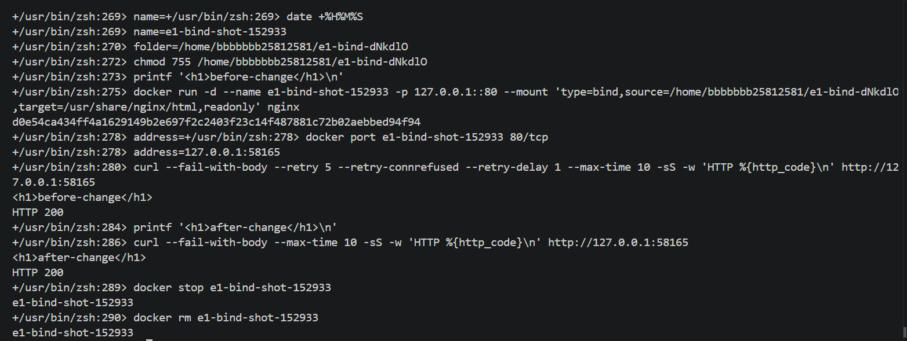

같은 주소에서 변경 전·후 본문과 두 번의 `HTTP 200`을 확인했다. 두 요청 사이에 재빌드·재시작 없이 호스트 파일만 수정했다. `HTTP 200` 행은 curl의 `-w` 옵션으로 실제 응답 상태 코드를 출력한 것이다. 마지막에 실습 컨테이너를 중지·삭제했다.

## Docker 볼륨 데이터 보존

볼륨을 만들고 컨테이너에 연결했다.

```powershell
docker volume create mission-data
docker run -d --name volume-test1 -v mission-data:/data ubuntu sleep infinity
docker exec volume-test1 sh -c "echo saved-in-volume > /data/hello.txt"
docker exec volume-test1 cat /data/hello.txt
```

첫 컨테이너를 삭제한 뒤 같은 볼륨을 새 컨테이너에 연결했다.

```powershell
docker rm -f volume-test1
docker volume ls
docker run -d --name volume-test2 -v mission-data:/data ubuntu sleep infinity
docker exec volume-test2 cat /data/hello.txt
```

새 컨테이너에서 saved-in-volume이 출력됐다. 컨테이너를 지워도 mission-data 볼륨의 파일은 남아 있음을 확인했다.

재설치 후에도 볼륨 목록과 파일 내용을 다시 확인했다.

```powershell
docker volume ls --format '{{.Name}}'
docker run --rm -v mission-data:/data:ro ubuntu cat /data/hello.txt
```

두 명령의 실제 출력은 차례대로 다음과 같다.

```text
mission-data
saved-in-volume
```

바인드 마운트는 내 PC의 `site` 폴더를 컨테이너에 직접 연결한다. 그래서 PC에서 `site/index.html`을 고치자 8081 페이지에 바로 반영됐다. 볼륨은 Docker가 관리하는 저장 공간이다. `mission-data`를 새 컨테이너에 다시 연결하자 `hello.txt`의 `saved-in-volume`이 남아 있었다. 웹페이지 원본을 PC에서 수정할 때는 바인드 마운트를, 컨테이너를 바꿔도 데이터를 보관할 때는 볼륨을 사용했다.

바인드 마운트는 PC에서 파일을 바로 열고 고치기 쉽지만, 그 파일과 경로를 PC에서 관리해야 한다. 볼륨은 Docker가 데이터를 관리해 컨테이너를 바꿔도 다시 연결하기 쉽지만, PC의 일반 폴더처럼 직접 편집하기는 불편하다. 두 방식의 속도는 이 과제에서 측정하지 않았다.

### WSL 볼륨 삭제 전·후 비교 보완 (2026-11-04)

기존 볼륨과 구분한 `e1-data-20261104151304`를 만들어 첫 컨테이너에서 파일을 썼다. 첫 컨테이너를 삭제하고 두 번째 컨테이너에 같은 볼륨을 연결해 내용을 다시 확인했다. 아래는 실제 명령·출력이며 추적 접두사는 생략했다.

```bash
docker volume create e1-data-20261104151304
```

```text
e1-data-20261104151304
```

```bash
docker run --name e1-data-20261104151304-first -v e1-data-20261104151304:/data ubuntu sh -c 'echo saved-in-volume > /data/hello.txt; cat /data/hello.txt'
```

```text
saved-in-volume
```

```bash
docker rm e1-data-20261104151304-first
```

```text
e1-data-20261104151304-first
```

```bash
docker run --name e1-data-20261104151304-second -v e1-data-20261104151304:/data ubuntu cat /data/hello.txt
```

```text
saved-in-volume
```

```bash
docker rm e1-data-20261104151304-second
```

```text
e1-data-20261104151304-second
```

```bash
docker volume inspect --format 'Name={{.Name}} Driver={{.Driver}}' e1-data-20261104151304
```

```text
Name=e1-data-20261104151304 Driver=local
```

첫 컨테이너 삭제 전과 삭제 후에 동일한 `saved-in-volume`을 확인했다. 두 번째 컨테이너에는 파일 쓰기 명령이 없으므로 같은 볼륨에 남은 데이터를 읽은 것이다. 두 컨테이너를 삭제한 뒤에도 `local` 드라이버의 볼륨이 존재했다. 확인용 볼륨은 이 시점에 삭제하지 않았다.

재현할 때는 기존 이름과 겹치지 않도록 새 볼륨·컨테이너 이름을 사용한다. 두 `docker run`은 작업을 끝내면 종료되는 방식이므로 삭제 전에 별도 중지 명령이 필요하지 않았다.

### 볼륨 영속성 실제 화면 증빙

기존 보완 실습에서 만든 `e1-data-20261104151304`를 읽기 전용으로 연결해 다시 확인했다. 다음은 실제 캡처에 대응하는 명령이다.

```bash
name=e1-volume-shot-152757
docker run --name "$name" -v e1-data-20261104151304:/data:ro ubuntu cat /data/hello.txt
docker rm "$name"
docker run --rm -v e1-data-20261104151304:/data:ro ubuntu cat /data/hello.txt
docker volume inspect --format 'Name={{.Name}} Driver={{.Driver}}' e1-data-20261104151304
```

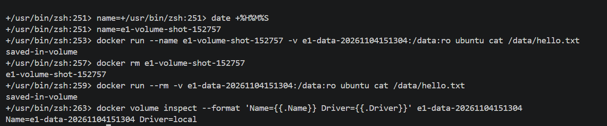

캡처에서 첫 컨테이너 삭제 전·후에 `saved-in-volume`이 출력됐고 마지막 조회에서 같은 볼륨이 남아 있었다. 두 컨테이너 모두 파일 쓰기 없이 읽기만 했다. 두 번째 컨테이너는 `--rm`으로 실행 종료 후 자동 삭제했다.

## Git 설정

실습 때 사용한 Git 명령:

```powershell
git --version
git config --global --get user.name
git config --global --get user.email
git config --global init.defaultBranch
git init -b main
git status
```

이름과 이메일이 설정돼 있었고, 기본 브랜치는 main이었다. 로컬 저장소를 만들고 GitHub 저장소에 업로드했다.

기본 브랜치 설정을 다시 확인한 실제 출력:

```powershell
git config --global --get init.defaultBranch
```

```text
main
```

원격 저장소 주소를 확인한 실제 출력:

```powershell
git remote -v
```

```text
origin  https://github.com/tikita12/E1-1.git (fetch)
origin  https://github.com/tikita12/E1-1.git (push)
```

`fetch`는 GitHub에서 가져올 때, `push`는 GitHub로 올릴 때 사용하는 주소다.

### WSL Ubuntu Git 설정 보완 확인 (2026-11-04)

Ubuntu 터미널에서 사용자 정보와 기본 브랜치 설정을 조회했다. 실제로 확인한 결과는 다음 세 항목이다.

```bash
git config --get-regexp '^(user\.(name|email)|init\.defaultbranch)$'
```

```text
user.name 장보윤
user.email bshine530@gmail.com
init.defaultbranch main
```

실제 WSL 환경·Git 조회 결과 캡처:

캡처에 대응하는 실행 명령:

```bash
uname -sr
pwd
git --version
git --no-pager config --get-regexp '^(user\.(name|email)|init\.defaultbranch)$'
git --no-pager branch --show-current
git --no-pager remote -v
```

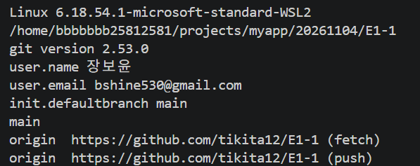

이미지는 출력 영역의 실제 캡처이며 입력 명령은 위 코드 블록에 별도로 제시했다. `--no-pager`는 결과를 별도 조회 화면으로 열지 않고 터미널에 출력하도록 한다.

`user.name`과 `user.email`은 커밋 작성자 정보이며 GitHub 로그인 성공을 뜻하지 않는다. `init.defaultbranch main`은 새 저장소를 초기화할 때 사용할 기본 브랜치 설정이다. 기존 저장소의 현재 브랜치나 원격 연결 여부는 이 출력만으로 확인할 수 없다.

Git은 로컬에서 파일 변경 이력과 커밋을 관리하는 도구이고, GitHub는 원격 저장소를 호스팅하며 코드 공유·협업 기능을 제공하는 서비스다. 사용자 설정, 현재 브랜치, 원격 주소 설정, 실제 원격 인증은 각각 구분해서 확인한다.

### WSL 저장소 브랜치·원격 주소 확인 (2026-11-04)

```bash
cd /home/bbbbbbb25812581/projects/myapp/20261104/E1-1
git --version
git branch --show-current
git remote -v
git status --short
```

위 명령 순서에 따른 실제 출력:

```text
git version 2.53.0
main
origin  https://github.com/tikita12/E1-1 (fetch)
origin  https://github.com/tikita12/E1-1 (push)
 M README.md
 M presentation/index.html
```

현재 브랜치는 `main`이며 `origin`의 가져오기·올리기 주소가 제출 저장소를 가리킨다. ` M`은 작업 폴더에서 파일이 수정됐고 아직 스테이징되지 않았음을 뜻한다. 이는 문서 보완 중 촬영한 상태이며 최종 제출 상태와 구분한다. `git remote -v`는 설정된 주소를 확인하는 명령이며 실제 원격 인증 성공을 증명하는 명령은 아니다. 기존 Windows의 SSH 원격 주소 기록과 달리 이번 WSL 작업 사본은 HTTPS 원격 주소를 사용한다.

## 트러블슈팅

### 포트가 이미 사용 중일 때 확인 방법

이 항목은 실제 발생 기록이 아닌 문제 해결 방법이다. `-p 8080:80` 실행 시 내 PC의 8080 포트를 다른 프로그램이나 컨테이너가 사용 중이라면 같은 포트를 다시 연결할 수 없다.

1. `docker ps`의 `PORTS` 열에서 8080을 쓰는 컨테이너가 있는지 확인한다.
2. 없으면 PowerShell에서 `Get-NetTCPConnection -LocalPort 8080 -ErrorAction SilentlyContinue`로 8080 포트를 쓰는 Windows 프로세스의 `OwningProcess` 번호를 확인하고, 그 번호를 `Get-Process -Id <번호>`에 넣어 프로그램 이름을 확인한다.
3. 해당 프로그램이나 컨테이너가 필요 없다면 프로그램을 닫거나 `docker stop <컨테이너이름>`으로 컨테이너를 멈춘 뒤 다시 확인한다. 계속 필요하다면 사용하지 않는 호스트 포트를 골라 `-p 8082:80`처럼 **왼쪽 숫자만** 바꾼다. 이때 접속 주소도 `http://localhost:8082`가 된다.

`8082`와 위 진단 명령은 설명을 위한 예시이며, 이 과제에서 실행해 확인한 포트는 8080과 8081이다.

### WSL에 Ubuntu 배포판이 표시되지 않음

- 문제: wsl --list --verbose에서 설치된 배포판이 없다고 표시됐다.
- 원인: WSL 및 Virtual Machine Platform 기능을 켠 뒤 재시작이 필요했다.
- 확인: 재시작 후 Ubuntu 초기 설정이 진행되고 WSL 2로 실행되는 것을 확인했다.
- 해결: 관리자 PowerShell에서 wsl --install -d Ubuntu를 실행하고 재시작했다.

### Docker Desktop 창이 열리지 않음 — 해결

- 문제: PowerShell의 `docker version`에서는 Client와 Server가 응답했지만 Docker Desktop 화면은 열리지 않았다. 화면 프로그램이 종료 코드 `2147483651` (`0x80000003`)로 반복 종료됐다.
- 확인한 원인: `Docker Desktop.exe.stderr.log`에 화면 프로그램이 설치 폴더 `C:\Users\bshin\AppData\Local\Programs\DockerDesktop\frontend`를 읽지 못한다는 오류가 기록됐다. 실제 폴더 권한에도 특정 AppContainer SID는 있었지만 `ALL APPLICATION PACKAGES`의 읽기·실행 권한은 없었다.
- 시도한 조치: Docker Desktop을 삭제 후 재설치하고 화면 가속도 꺼봤지만 같은 오류가 계속됐다.
- 해결: 기존 폴더 권한을 백업한 뒤, 해당 `frontend` 폴더와 하위 파일·폴더에 `ALL APPLICATION PACKAGES` (`S-1-15-2-1`)의 읽기·실행 권한을 추가하고 Docker Desktop을 재시작했다.

당시 `Docker Desktop.exe.stderr.log`에서 확인한 원본 오류 한 줄:

```text
[2026-11-02T16:14:52.111387100Z] [15972:1103/011452.111:FATAL:electron\shell\browser\win\install_dir_access.cc:52] Sandboxed processes cannot read C:\Users\bshin\AppData\Local\Programs\DockerDesktop\frontend: its ACL has an entry for an AppContainer package SID but none for ALL APPLICATION PACKAGES, so Windows denies the sandbox token access. Grant it with: icacls "C:\Users\bshin\AppData\Local\Programs\DockerDesktop\frontend" /grant *S-1-15-2-1:(OI)(CI)(RX)
```

권한 수정 후 `icacls`로 다시 확인한 관련 출력:

```text
C:\Users\bshin\AppData\Local\Programs\DockerDesktop\frontend APPLICATION PACKAGE AUTHORITY\ALL APPLICATION PACKAGES:(OI)(CI)(RX)
Successfully processed 1 files; Failed processing 0 files
```

이 PC에서 적용한 권한 수정 명령:

```powershell
icacls "C:\Users\bshin\AppData\Local\Programs\DockerDesktop\frontend" /grant "*S-1-15-2-1:(OI)(CI)(RX)"
```

- 결과: Welcome 화면과 Containers 대시보드가 실제로 열렸고, 화면에서 `Engine running`을 확인했다.

### Ubuntu 터미널에서 Docker 명령을 찾지 못함 — 해결

- 문제: PowerShell에서는 Docker 엔진에 연결됐지만 Ubuntu에서는 `docker` 명령을 찾을 수 없다는 안내가 나왔다.
- 확인한 원인: Docker Desktop 설정에서 기본 WSL 배포판 연동이 꺼져 있었다. `wsl --list --verbose`에서 기본 배포판은 Ubuntu, 버전은 WSL 2로 확인됐다.
- 해결: 복구된 Docker Desktop의 Settings → WSL integration에서 `Enable integration with my default WSL distro`를 켜고 `Apply & Restart Engine`을 눌렀다.
- 결과: 설정 적용과 엔진 재시작 후 아래 명령이 종료 코드 0으로 성공했다. Ubuntu의 Linux 클라이언트와 Docker Desktop 서버가 모두 응답했으며, Docker Engine 버전은 `29.9.2`였다.

```powershell
wsl -d Ubuntu -- docker version
```

### 재설치 후 과제 환경 복구

- 삭제 전 `mission-data` 볼륨을 Windows 임시 폴더의 `mission-data-backup.tar.gz`로 백업했다. 재설치 후 볼륨을 다시 만들고 백업을 풀었다.
- 아래 확인 명령에서 `saved-in-volume`이 출력돼 `hello.txt` 데이터 복구를 확인했다.

```powershell
docker run --rm -v mission-data:/data:ro ubuntu cat /data/hello.txt
```

- 과제 폴더의 Dockerfile로 `mission-web:1.0` 이미지를 다시 빌드하고, `mission-web-container`를 실행했다. 브라우저에서 `http://localhost:8080` 접속을 확인했다.
- `site` 폴더를 연결한 `mission-web-bind` 컨테이너를 다시 실행하고, `http://localhost:8081` 접속을 확인했다.
- `site/index.html`의 문구를 `bind mount works!`에서 `bind mount restored!`로 바꾸고 저장했다. 이미지 재빌드 없이 8081 페이지를 새로고침해 변경된 문구가 표시되는 것을 확인했다.

## 보너스: Docker Compose 단일 서비스

`compose.yaml`에 현재 폴더의 Dockerfile 빌드와 포트 연결을 적고 Compose로 웹 서버 하나를 실행했다. 기존 컨테이너가 사용하는 8080·8081 포트를 피하려고 8082를 사용했다.

```yaml
services:
  web:
    build: .
    ports:
      - "8082:80"
```

설정 확인과 실행 명령:

```powershell
docker compose config
docker compose up -d
docker compose ps
curl.exe -i http://localhost:8082
```

`docker compose config`에서 빌드 경로가 과제 폴더, 포트가 `8082 → 80`으로 표시됐다. `docker compose up -d`의 실제 결과는 이미지 빌드와 컨테이너 시작 성공이었다.

```text
✔ Image mission-web-web       Built
✔ Network mission-web_default Created
✔ Container mission-web-web-1 Started
```

실행 상태 확인:

```text
NAME                IMAGE             COMMAND                   SERVICE   CREATED          STATUS          PORTS
mission-web-web-1   mission-web-web   "/docker-entrypoint.…"   web       35 seconds ago   Up 35 seconds   0.0.0.0:8082->80/tcp, [::]:8082->80/tcp
```

웹 접속 결과:

```http
HTTP/1.1 200 OK
Server: nginx/1.31.8
Content-Type: text/html

<h1>bind mount restored!</h1>
```

Compose는 실행 설정을 YAML 파일에 보관하고, `docker compose up -d`로 그 설정을 실행한다. `build`는 이미지를 만들고, `ports`는 호스트와 컨테이너 포트를 연결한다.

## 보너스: Docker Compose 멀티 컨테이너와 운영

`compose-multi.yaml`은 웹 서버와 통신 확인용 BusyBox 보조 서비스를 함께 실행한다. Compose가 두 서비스를 같은 기본 네트워크에 연결한다.

```powershell
docker compose -f compose-multi.yaml config
docker compose -f compose-multi.yaml up -d
docker compose -f compose-multi.yaml ps
docker compose -f compose-multi.yaml exec helper wget -qO- http://web
docker compose -f compose-multi.yaml logs
docker compose -f compose-multi.yaml down
```

실행 후 두 서비스가 모두 `Up` 상태였고, `helper`에서 `http://web`을 요청해 다음 응답을 받았다. 서비스 이름 `web`으로 같은 네트워크의 컨테이너를 찾을 수 있음을 확인했다.

```text
<h1>bind mount restored!</h1>
```

로그에서 NGINX의 정상 시작과 HTTP 200 응답도 확인했다. `down` 실행 후 두 컨테이너와 Compose 네트워크가 제거됐다.

## 보너스: Compose 환경 변수

`compose-env.yaml`에서 `APP_MODE` 환경 변수를 `practice`로 지정하고 NGINX 설정 템플릿에서 응답 헤더에 표시했다. 호스트의 8084 포트를 컨테이너의 80 포트에 연결했다.

```powershell
docker compose -f compose-env.yaml config
docker compose -f compose-env.yaml up -d
curl.exe -i http://localhost:8084
```

실제 HTTP 응답에서 `200 OK`와 환경 변수 값이 들어간 헤더를 확인했다.

```http
HTTP/1.1 200 OK
X-App-Mode: practice

<h1>bind mount restored!</h1>
```

## 보너스: GitHub SSH 연결

ED25519 키 쌍을 만들고 공개 키를 GitHub에 등록했다. 개인 키는 저장소에 넣지 않았다. SSH 인증 명령과 실제 응답:

```powershell
ssh -T git@github.com
```

```text
Hi tikita12! You've successfully authenticated, but GitHub does not provide shell access.
```

`origin`을 SSH 주소로 바꾸고 실제 원격 주소를 확인했다.

```text
origin  git@github.com:tikita12/E1-1.git (fetch)
origin  git@github.com:tikita12/E1-1.git (push)
```

이제 GitHub로 push할 때 이 SSH 연결을 사용할 수 있다.

## GitHub 제출

- GitHub 저장소: 완료 (`https://github.com/tikita12/E1-1`, `main` 브랜치 업로드 확인)
- VS Code와 GitHub 연동: 완료 (저장소 `origin`이 GitHub 저장소를 가리키는 것 확인)
- VS Code와 GitHub 연동 화면:

  
