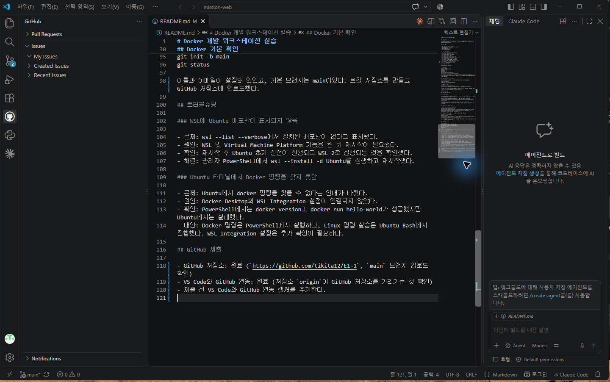

# Docker 개발 워크스테이션 실습

## 미션 목표

터미널에서 파일과 폴더, 권한을 다루고 Docker 이미지와 컨테이너를 실행했다. Dockerfile로 NGINX 웹 서버 이미지를 만들고, 포트 연결, 바인드 마운트, 볼륨의 데이터 보존을 확인했다.

## 실행 환경

- OS: Windows Pro, 빌드 26200
- 터미널: PowerShell, Ubuntu Bash (WSL 2)
- Docker Desktop: 4.97.0
- Docker Engine: 29.9.2
- Git: 2.55.0.windows.5

## 수행 체크리스트

- [x] 터미널 위치·목록·파일·폴더 조작
- [x] 파일과 폴더 권한 변경
- [x] Docker 버전과 엔진 확인
- [x] `hello-world` 실행
- [x] Ubuntu 컨테이너에서 명령 실행
- [x] Dockerfile로 NGINX 커스텀 이미지 빌드
- [x] 포트 매핑으로 웹 페이지 접속
- [x] 바인드 마운트로 파일 변경 반영
- [x] Docker 볼륨의 데이터 보존 확인
- [x] Git 사용자 정보와 기본 브랜치 확인
- [x] GitHub 저장소 생성 및 업로드
- [x] VS Code와 GitHub 연동 완료
- [x] Docker Desktop 화면 실행 오류 해결 및 Ubuntu WSL 연동 확인

## 프로젝트 폴더 구성

루트 폴더에서 확인한 실제 목록:

```powershell
get-childitem -name
```

```text
docs
evidence
site
Dockerfile
README.md
```

웹사이트 원본, 실행 방법, 확인 자료를 찾기 쉽게 나누었다.

| 경로 | 역할 |
| --- | --- |
| `site/index.html` | NGINX가 제공하는 웹페이지 원본 |
| `Dockerfile` | `site` 폴더를 NGINX 이미지에 복사하는 빌드 설명서 |
| `README.md` | 실습 명령, 실제 출력, 개념과 문제 해결 기록 |
| `docs/screenshots/` | VS Code와 GitHub 연동 화면 이미지 |
| `evidence/` | Docker 정보와 8081 웹 접속을 확인한 보조 이미지 |

## Linux 파일 권한 변경 실습

Ubuntu의 사용자 폴더에서 실습용 파일을 만들고, 권한 변경 전후의 실제 출력을 확인했다.

```bash
mkdir -p ~/permission-practice
touch ~/permission-practice/hello.txt
ls -l ~/permission-practice/hello.txt
```

```text
-rw-r--r-- 1 bshin bshin 0 Nov  3 13:02 /home/bshin/permission-practice/hello.txt
```

`chmod 600`으로 파일 주인에게만 읽기와 쓰기 권한을 남겼다.

```bash
chmod 600 ~/permission-practice/hello.txt
ls -l ~/permission-practice/hello.txt
```

```text
-rw------- 1 bshin bshin 0 Nov  3 13:02 /home/bshin/permission-practice/hello.txt
```

권한 숫자는 주인·그룹·그 밖의 사용자 순서다. 읽기(`r`)는 4, 쓰기(`w`)는 2, 실행(`x`)은 1이며 허용할 권한을 더한다. 따라서 `600`은 주인에게 읽기와 쓰기(`4+2=6`)를 주고, 그룹과 그 밖의 사용자에게는 권한을 주지 않는다는 뜻이다.

## Docker 기본 확인

PowerShell에서 실행했다.

Docker Desktop 실행 상태를 확인한 실제 출력:

```powershell
docker desktop status
```

```text
Name                Value
Status              running
SessionID           df3483af-556f-44ea-9636-e5ccaf363bd1
```

Docker CLI 버전을 확인한 실제 출력:

```powershell
docker --version
```

```text
Docker version 29.9.2, build a82e528
```

```powershell
docker version
docker run hello-world
docker images
docker ps
docker ps -a
docker logs ubuntu-practice
docker stats --no-stream ubuntu-practice
```

`docker run hello-world` 실행 결과:

```text
Unable to find image 'hello-world:latest' locally
latest: Pulling from library/hello-world
4f55086f7dd0: Pull complete
d5e71e642bf5: Download complete
Digest: sha256:c567b231f65614688711a75f31518a064258a51d442117a3e771a3a8fdba78ef
Status: Downloaded newer image for hello-world:latest

Hello from Docker!
This message shows that your installation appears to be working correctly.

To generate this message, Docker took the following steps:
 1. The Docker client contacted the Docker daemon.
 2. The Docker daemon pulled the "hello-world" image from the Docker Hub.
    (amd64)
 3. The Docker daemon created a new container from that image which runs the
    executable that produces the output you are currently reading.
 4. The Docker daemon streamed that output to the Docker client, which sent it
    to your terminal.

To try something more ambitious, you can run an Ubuntu container with:
 $ docker run -it ubuntu bash

Share images, automate workflows, and more with a free Docker ID:
 https://hub.docker.com/

For more examples and ideas, visit:
 https://docs.docker.com/get-started/
```

`docker images` 실행 결과 (`U`는 사용 중인 이미지 표시):

```text
IMAGE                ID             DISK USAGE   CONTENT SIZE   EXTRA
hello-world:latest   c567b231f656       25.9kB         9.49kB    U
mission-web:1.0      da9b11e9b04b       93.6MB         26.3MB    U
nginx:alpine         785835ea65db       94.5MB         27.2MB    U
ubuntu:latest        6a06111c3b0a        163MB         45.9MB
```

`docker ps -a` 실행 결과:

```text
CONTAINER ID   IMAGE             COMMAND                   CREATED              STATUS                          PORTS                                     NAMES
d60ff015c57f   hello-world       "/hello"                  About a minute ago   Exited (0) About a minute ago                                             brave_einstein
e2997fda17a9   nginx:alpine      "/docker-entrypoint.…"   38 minutes ago       Up 38 minutes                   0.0.0.0:8081->80/tcp, [::]:8081->80/tcp   mission-web-bind
1004abfc7dda   mission-web:1.0   "/docker-entrypoint.…"   39 minutes ago       Up 39 minutes                   0.0.0.0:8080->80/tcp, [::]:8080->80/tcp   mission-web-container
```

hello-world 출력에서 Hello from Docker!를 확인했다. Ubuntu 컨테이너에서는 ls와 echo를 실행했다. docker exec로 연 Bash에서 exit한 뒤에도 컨테이너가 계속 실행되는 것을 확인했다.

## 웹 서버 이미지와 포트 연결

site/index.html을 NGINX 웹 서버가 제공하도록 Dockerfile을 작성했다.

실제 `Dockerfile` 내용:

```dockerfile
FROM nginx:alpine
COPY site/ /usr/share/nginx/html/
```

`FROM`은 사용할 기본 이미지가 `nginx:alpine`임을 뜻한다. `COPY`는 이 폴더의 `site/` 내용을 이미지 안의 `/usr/share/nginx/html/`에 복사한다.

빌드와 실행 명령:

docker build -t mission-web:1.0 .
docker run -d --name mission-web-container -p 8080:80 mission-web:1.0

이미지를 다시 빌드하며 확인한 실제 출력 (`CACHED`는 기존 기본 이미지 재사용을 뜻한다):

```text
[+] Building 1.1s (7/7) FINISHED                                                  docker:desktop-linux
 => [internal] load build definition from Dockerfile                                              0.0s
 => => transferring dockerfile: 91B                                                               0.0s
 => [internal] load metadata for docker.io/library/nginx:alpine                                   0.1s
 => [internal] load .dockerignore                                                                 0.0s
 => => transferring context: 2B                                                                   0.0s
 => CACHED [1/2] FROM docker.io/library/nginx:alpine@sha256:785835ea65db4bba6f021acc0f3be91b0fef  0.1s
 => => resolve docker.io/library/nginx:alpine@sha256:785835ea65db4bba6f021acc0f3be91b0fef76a53fe  0.1s
 => [internal] load build context                                                                 0.0s
 => => transferring context: 101B                                                                 0.0s
 => [2/2] COPY site/ /usr/share/nginx/html/                                                       0.1s
 => exporting to image                                                                            0.5s
 => => exporting layers                                                                           0.2s
 => => exporting manifest sha256:5e662e58d1c7482e23721ee01ea256b423602ba2ce17b0c5ea16725e96db43c  0.1s
 => => exporting config sha256:9d8802f8a45a4c2790090ea3fc89e06760d57ccb0b998de402bb253058af3298   0.0s
 => => exporting attestation manifest sha256:e993b3ebca3145f97a34950a13a7589509f077cef94d7e06a2d  0.0s
 => => exporting manifest list sha256:0d36ee2965e082439404929aa6c041fefdd348181db29a9a7ec1edfe63  0.0s
 => => naming to docker.io/library/mission-web:1.0                                                0.0s
 => => unpacking to docker.io/library/mission-web:1.0                                             0.1s
```

브라우저에서 http://localhost:8080으로 접속해 페이지를 확인했다. 호스트의 8080 포트 요청이 컨테이너의 NGINX 80 포트로 전달된다.

Windows 호스트에서 확인한 8080 포트의 실제 HTTP 응답:

```powershell
curl.exe -i http://localhost:8080
```

```http
HTTP/1.1 200 OK
Server: nginx/1.31.8
Date: Tue, 03 Nov 2026 04:13:25 GMT
Content-Type: text/html
Content-Length: 28
Last-Modified: Mon, 02 Nov 2026 12:07:37 GMT
Connection: keep-alive
ETag: "6ae87d09-1c"
Accept-Ranges: bytes

<h1>bind mount works!</h1>
```

8080 컨테이너는 앞서 빌드한 이미지로 실행 중이므로, 새 빌드 후에도 기존 컨테이너의 페이지 문구가 그대로 표시됐다.

Docker 정보 확인

웹 페이지와 포트 접속

## 바인드 마운트

호스트의 site 폴더를 컨테이너의 NGINX 웹 폴더에 연결했다. 호스트 경로는 내 PC의 프로젝트 위치에 맞게 바꿔야 한다.

docker run -d --name mission-web-bind -p 8081:80 --mount "type=bind,source=C:\Users\bshin\mission-web\site,target=/usr/share/nginx/html,readonly" nginx:alpine

Windows 호스트에서 확인한 8081 포트의 실제 HTTP 응답:

```powershell
curl.exe -i http://localhost:8081
```

```http
HTTP/1.1 200 OK
Server: nginx/1.31.8
Date: Tue, 03 Nov 2026 04:13:57 GMT
Content-Type: text/html
Content-Length: 31
Last-Modified: Tue, 03 Nov 2026 03:33:30 GMT
Connection: keep-alive
ETag: "6ae9560a-1f"
Accept-Ranges: bytes

<h1>bind mount restored!</h1>
```

호스트의 site/index.html 내용을 Bind mount works!로 바꾼 뒤 http://localhost:8081을 새로고침했다. 이미지를 다시 빌드하지 않아도 변경된 페이지가 표시됐다.

## Docker 볼륨 데이터 보존

볼륨을 만들고 컨테이너에 연결했다.

docker volume create mission-data
docker run -d --name volume-test1 -v mission-data:/data ubuntu sleep infinity
docker exec volume-test1 sh -c "echo saved-in-volume > /data/hello.txt"
docker exec volume-test1 cat /data/hello.txt

첫 컨테이너를 삭제한 뒤 같은 볼륨을 새 컨테이너에 연결했다.

docker rm -f volume-test1
docker volume ls
docker run -d --name volume-test2 -v mission-data:/data ubuntu sleep infinity
docker exec volume-test2 cat /data/hello.txt

새 컨테이너에서 saved-in-volume이 출력됐다. 컨테이너를 지워도 mission-data 볼륨의 파일은 남아 있음을 확인했다.

## Git 설정

git --version
git config --global --get user.name
git config --global --get user.email
git config --global init.defaultBranch
git init -b main
git status

이름과 이메일이 설정돼 있었고, 기본 브랜치는 main이었다. 로컬 저장소를 만들고 GitHub 저장소에 업로드했다.

원격 저장소 주소를 확인한 실제 출력:

```powershell
git remote -v
```

```text
origin  https://github.com/tikita12/E1-1.git (fetch)
origin  https://github.com/tikita12/E1-1.git (push)
```

`fetch`는 GitHub에서 가져올 때, `push`는 GitHub로 올릴 때 사용하는 주소다.

## 트러블슈팅

### WSL에 Ubuntu 배포판이 표시되지 않음

- 문제: wsl --list --verbose에서 설치된 배포판이 없다고 표시됐다.
- 원인: WSL 및 Virtual Machine Platform 기능을 켠 뒤 재시작이 필요했다.
- 확인: 재시작 후 Ubuntu 초기 설정이 진행되고 WSL 2로 실행되는 것을 확인했다.
- 해결: 관리자 PowerShell에서 wsl --install -d Ubuntu를 실행하고 재시작했다.

### Docker Desktop 창이 열리지 않음 — 해결

- 문제: PowerShell의 `docker version`에서는 Client와 Server가 응답했지만 Docker Desktop 화면은 열리지 않았다. 화면 프로그램이 종료 코드 `2147483651` (`0x80000003`)로 반복 종료됐다.
- 확인한 원인: `Docker Desktop.exe.stderr.log`에 화면 프로그램이 설치 폴더 `C:\Users\bshin\AppData\Local\Programs\DockerDesktop\frontend`를 읽지 못한다는 오류가 기록됐다. 실제 폴더 권한에도 특정 AppContainer SID는 있었지만 `ALL APPLICATION PACKAGES`의 읽기·실행 권한은 없었다.
- 시도한 조치: Docker Desktop을 삭제 후 재설치하고 화면 가속도 꺼봤지만 같은 오류가 계속됐다.
- 해결: 기존 폴더 권한을 백업한 뒤, 해당 `frontend` 폴더와 하위 파일·폴더에 `ALL APPLICATION PACKAGES` (`S-1-15-2-1`)의 읽기·실행 권한을 추가하고 Docker Desktop을 재시작했다.

이 PC에서 적용한 권한 수정 명령:

```powershell
icacls "C:\Users\bshin\AppData\Local\Programs\DockerDesktop\frontend" /grant "*S-1-15-2-1:(OI)(CI)(RX)"
```

- 결과: Welcome 화면과 Containers 대시보드가 실제로 열렸고, 화면에서 `Engine running`을 확인했다.

### Ubuntu 터미널에서 Docker 명령을 찾지 못함 — 해결

- 문제: PowerShell에서는 Docker 엔진에 연결됐지만 Ubuntu에서는 `docker` 명령을 찾을 수 없다는 안내가 나왔다.
- 확인한 원인: Docker Desktop 설정에서 기본 WSL 배포판 연동이 꺼져 있었다. `wsl --list --verbose`에서 기본 배포판은 Ubuntu, 버전은 WSL 2로 확인됐다.
- 해결: 복구된 Docker Desktop의 Settings → WSL integration에서 `Enable integration with my default WSL distro`를 켜고 `Apply & Restart Engine`을 눌렀다.
- 결과: 설정 적용과 엔진 재시작 후 아래 명령이 종료 코드 0으로 성공했다. Ubuntu의 Linux 클라이언트와 Docker Desktop 서버가 모두 응답했으며, Docker Engine 버전은 `29.9.2`였다.

```powershell
wsl -d Ubuntu -- docker version
```

### 재설치 후 과제 환경 복구

- 삭제 전 `mission-data` 볼륨을 Windows 임시 폴더의 `mission-data-backup.tar.gz`로 백업했다. 재설치 후 볼륨을 다시 만들고 백업을 풀었다.
- 아래 확인 명령에서 `saved-in-volume`이 출력돼 `hello.txt` 데이터 복구를 확인했다.

```powershell
docker run --rm -v mission-data:/data:ro ubuntu cat /data/hello.txt
```

- 과제 폴더의 Dockerfile로 `mission-web:1.0` 이미지를 다시 빌드하고, `mission-web-container`를 실행했다. 브라우저에서 `http://localhost:8080` 접속을 확인했다.
- `site` 폴더를 연결한 `mission-web-bind` 컨테이너를 다시 실행하고, `http://localhost:8081` 접속을 확인했다.
- `site/index.html`의 문구를 `bind mount works!`에서 `bind mount restored!`로 바꾸고 저장했다. 이미지 재빌드 없이 8081 페이지를 새로고침해 변경된 문구가 표시되는 것을 확인했다.

## GitHub 제출

- GitHub 저장소: 완료 (`https://github.com/tikita12/E1-1`, `main` 브랜치 업로드 확인)
- VS Code와 GitHub 연동: 완료 (저장소 `origin`이 GitHub 저장소를 가리키는 것 확인)
- VS Code와 GitHub 연동 화면:

  
